# Opuscar VN

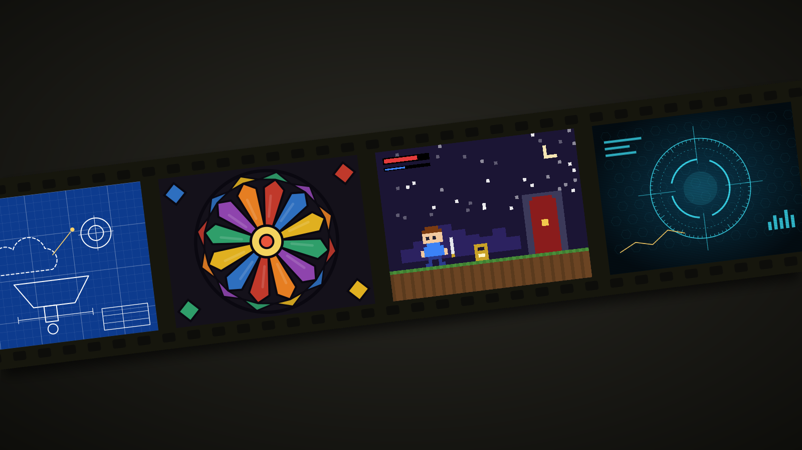

<sub>Hình minh họa vẽ riêng cho kho này, không phải khung phim thật.</sub>

**Bộ công cụ phong cách phim dựng hoàn toàn bằng code: 66 phong cách có sẵn, và phong cách riêng của bạn.**

Chọn một phong cách (hoặc tự tạo từ trang trắng), đưa câu chuyện của bạn, rồi để coding agent đạo diễn: agent vẽ hình, soạn nhạc, thu giọng đọc, trộn âm và xuất phim.

> **Dành cho Claude.** Các phong cách được tinh chỉnh cho Claude Opus 5.5. Model khác có thể không tái tạo tốt, hãy dùng thận trọng.

Mọi bộ phim được tạo ra theo cách này đều do agent viết code:

- **Hình**: trang canvas và WebGL, kết xuất từng khung hình
- **Nhạc**: nhạc nền gốc dựng từ các thư viện mẫu âm miễn phí
- **Giọng**: đọc lời bằng text-to-speech

Không dùng AI sinh video, không dùng cảnh stock.

## Một vài phong cách

| | | | |
|---|---|---|---|
| <a href="styles/whiteboard/STYLE.md">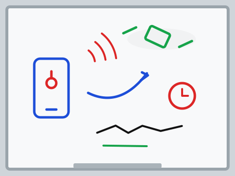</a><br>Bảng trắng | <a href="styles/watercolor/STYLE.md">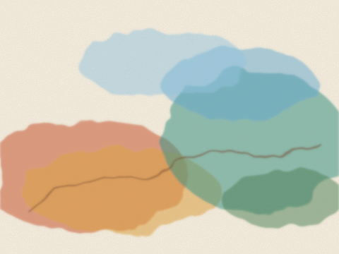</a><br>Màu nước | <a href="styles/ukiyoe/STYLE.md">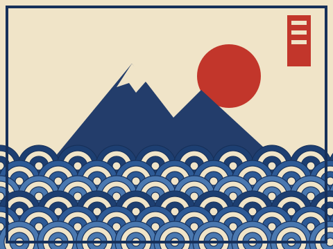</a><br>Ukiyo-e | <a href="styles/pixel-rpg/STYLE.md">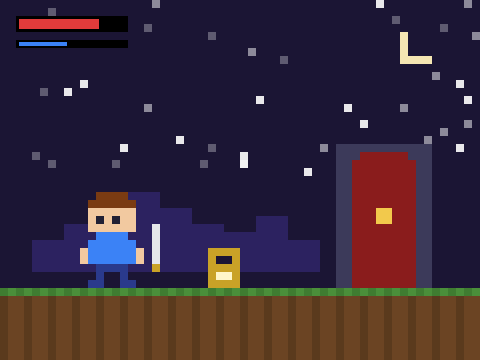</a><br>Pixel RPG |
| <a href="styles/blueprint/STYLE.md"></a><br>Bản vẽ kỹ thuật | <a href="styles/risograph/STYLE.md">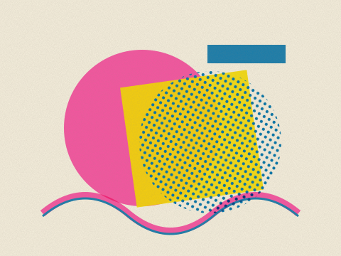</a><br>In Risograph | <a href="styles/woodcut/STYLE.md">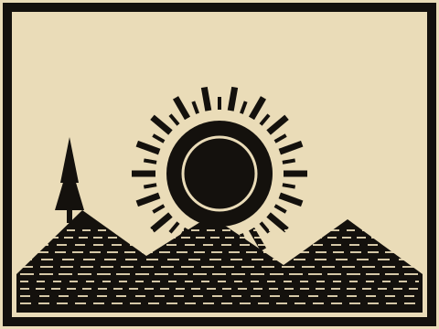</a><br>Khắc gỗ | <a href="styles/stained-glass/STYLE.md">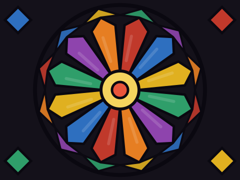</a><br>Kính màu |
| <a href="styles/swiss-motion/STYLE.md">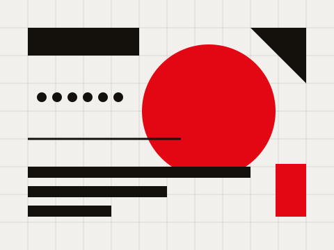</a><br>Đồ họa Thụy Sĩ | <a href="styles/hologram-hud/STYLE.md">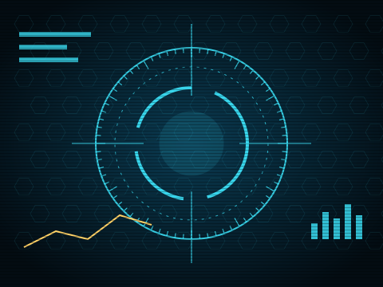</a><br>Giao diện hologram | <a href="styles/silent-film/STYLE.md">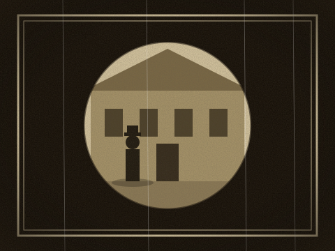</a><br>Phim câm | <a href="styles/chalkboard/STYLE.md"></a><br>Bảng phấn |

<sub>Hình minh họa vẽ riêng cho kho này. Bấm vào để đọc `STYLE.md` của từng phong cách.</sub>

## Cách dùng

Có hai cách vào. Cách cài skill là dễ nhất.

### Cách 1: cài skill (khuyên dùng)

Trong terminal:

```sh
claude plugin marketplace add andyluu98/opuscar-vn
claude plugin install opuscar-vn@opuscar-vn
```

Sau đó khởi động lại Claude Code và dùng từ bất kỳ thư mục nào.

- Lần dùng đầu tiên, skill tải hướng dẫn, công cụ và prompt phong cách về `~/opuscar-vn`, dùng chung cho mọi bộ phim.
- Dự án của từng bộ phim, từ mã nguồn tới video hoàn chỉnh, nằm trong thư mục anh đang đứng khi bắt đầu.
- Với agent khác, chép thư mục [`plugin/skills/lemo-opuscar/`](plugin/skills/lemo-opuscar/) vào thư mục skill của agent đó.

### Cách 2: clone repo

```sh
git clone https://github.com/andyluu98/opuscar-vn.git
cd opuscar-vn
claude
```

Phim nằm trong `films/<tên>/` bên trong repo.

### Chỉ cần nói điều bạn muốn

> Làm phim 45 giây theo phong cách **watercolor** về trang trại cà phê gia đình tôi. Giọng nữ ấm áp.

> Làm phim 40 giây theo phong cách **LiDAR Survey** về mỏ đá cũ trên đồi sau thị trấn, từ dữ liệu quét laser công khai.

Gọi tên phong cách bằng tiếng Anh hoặc tên thư mục; [bảng phong cách](styles/README.md) liệt kê tất cả.

Chưa chắc? Khi đã cài skill, gõ `/opuscar-vn:lemo-opuscar` và không gõ gì thêm. Agent hỏi ngôn ngữ, rồi hỏi bạn muốn làm gì: phim theo một phong cách có sẵn, tạo phong cách riêng, hoặc phim theo phong cách bạn đã lưu.

Agent chỉ hỏi một lần ngay từ đầu:

- những chỗ nó không tự quyết được về chủ đề của bạn;
- bạn có **giọng, nhạc hay tư liệu** riêng không;
- bạn có muốn xem **storyboard** trước không. Nếu có, nó dừng một lần để cho xem các cảnh chính đúng phong cách; nếu không, nó làm thẳng ra phim hoàn chỉnh.

Agent đọc ba tài liệu và làm việc như một xưởng phim nhỏ:

| Tệp | Agent nhận được gì |
|---|---|
| [`DIRECTOR.md`](DIRECTOR.md) | cách đạo diễn: câu chuyện, âm thanh, nhịp, máy quay, diễn xuất, tự kiểm tra |
| [`TECHNIQUE.md`](TECHNIQUE.md) | cách dựng: kết xuất từng khung, giọng đọc, nhạc, trộn âm |
| `styles/<phong-cách>/STYLE.md` | phong cách nhìn và nghe ra sao; câu chuyện là của bạn |

### Tạo phong cách riêng

Mỗi người muốn một thứ khác nhau: màu thương hiệu, logo, nhân vật, giọng điệu kênh. Bạn có thể biến một phong cách có sẵn thành phong cách chỉ của bạn, hoặc tạo phong cách mới từ trang trắng.

**Hai đường vào.** Chọn sau khi khởi động skill, hoặc nói một câu:

> Tôi muốn đổi phong cách **Ukiyo-e** thành bản của riêng tôi.

> Bắt đầu từ trang trắng: phong cách phấn trên bảng đen, ấm và chậm.

- **Đổi một phong cách có sẵn**: agent liệt kê các phong cách, bạn gõ tên cái cần đổi.
- **Bắt đầu từ trang trắng**: tả hình ảnh bằng lời của bạn, hoặc đưa ảnh hay phim bạn thích. Claude chọn phong cách gần nhất làm nền kỹ thuật, nói lý do, bạn đồng ý hoặc chọn cái khác.

**Rồi năm bước:**

1. **Lên kế hoạch, mỗi lần một câu hỏi.** Mỗi câu có vài lựa chọn, cái nên chọn đặt đầu kèm lý do. Gồm: dùng để làm gì (loại phim, nền tảng, màu thương hiệu, logo, phông, nhân vật lặp lại), đổi gì (an toàn để đổi, đổi tính cách phong cách, hay không thể đổi vì là bản chất), hướng đi cho từng phần, và cuối cùng là tên. Nói mơ hồ cũng được, ví dụ "cao cấp hơn" hay "sống động hơn", agent đổi thành các thay đổi cụ thể để chọn. Mỗi vòng tối đa năm thay đổi khi đổi phong cách có sẵn; mọi thứ vẽ bằng code, không sinh ảnh AI.
2. **Xem bản tóm tắt.** Từng phần trước, sau, và cái giá phải trả. Chưa đồng ý thì chưa ghi gì.
3. **Xem trước một khung hình**, vẽ bằng code thật. Khi đổi phong cách có sẵn, cùng khung đó cũng được dựng ở bản gốc, đặt cạnh nhau: gốc bên trái, của bạn bên phải. Sau hai vòng mà chưa đúng, agent nói thẳng và gợi ý nền gần hơn.
4. **Phim mẫu 15 đến 30 giây.** Mọi thay đổi đều có trên màn hình, kèm nhạc và hiệu ứng âm thanh. Agent kiểm phim và sửa một lần trước khi giao.
5. **Giữ lại khi hài lòng.** Agent hỏi: giữ làm phong cách của tôi, thêm một vòng, hoặc để sau. Chưa đồng ý thì mọi thứ vẫn nằm trong thư mục dự án đó.

Khi đã giữ, phong cách nằm ở `~/lemo-my-styles/<tên>/`, có cấu trúc như phong cách trong thư viện: prompt phong cách, những gì đã đổi, phim mẫu và mã nguồn của nó. Lần sau gọi tên như mọi phong cách khác: *"Làm phim 30 giây theo phong cách **Night Ukiyo-e** của tôi về…"*. Khi chọn phong cách, phong cách của bạn được liệt kê trước.

Cập nhật thư viện hay cài lại không đụng tới các phong cách này. Các bước agent làm nằm trong [`MY-STYLES.md`](MY-STYLES.md).

### Trước khi bắt đầu

- Một bộ phim tốn agent khoảng 30 đến 60 phút và khá nhiều token.
- Cần Node 20+, ffmpeg 7+ và Python 3.11+ (hoặc [uv](https://docs.astral.sh/uv/)); agent tự cài phần còn lại. Ubuntu 24.04 đi kèm ffmpeg 6.1 là quá cũ: dùng [bản build tĩnh](https://johnvansickle.com/ffmpeg/).
- Đầu ra mặc định 1920×1080, 24 khung/giây; kích thước khác theo yêu cầu.
- Các gói lớn (mô hình giọng Kokoro, thư viện mẫu nhạc cụ) tải bằng `sh tools/fetch.sh`, nguồn khai báo trong `tools/assets.json`.

### Cập nhật hoặc gỡ

Cập nhật, rồi khởi động lại Claude Code (thư viện trong `~/opuscar-vn` tự cập nhật ở bộ phim kế tiếp):

```sh
claude plugin marketplace update opuscar-vn && claude plugin update opuscar-vn@opuscar-vn
```

Gỡ cài, rồi xóa `~/opuscar-vn`:

```sh
claude plugin uninstall opuscar-vn@opuscar-vn
```

Các phong cách riêng trong `~/lemo-my-styles/` được giữ qua cập nhật và gỡ cài; tự xóa thư mục đó nếu không cần.

## Các phong cách (66)

Bấm vào tên để mở `STYLE.md` của phong cách.

### Dựng phim và tư liệu thật (8)

| Phong cách | Thư mục | Dùng cho |
|---|---|---|
| Caption News | [`caption-news`](styles/caption-news/STYLE.md) | Social news, Report explainers, Data shorts |
| Time-lapse Symphony | [`city-symphony`](styles/city-symphony/STYLE.md) | City films, Music montages, Openers |
| Live Countdown Split-screen | [`countdown`](styles/countdown/STYLE.md) | Launches, Countdowns, Live events |
| Constructivist Montage | [`kino-montage`](styles/kino-montage/STYLE.md) | Industry histories, Milestones, Collective effort |
| Broadcast News Package | [`news-package`](styles/news-package/STYLE.md) | News round-ups, Bulletins, Market updates |
| 1920s Newsreel | [`newsreel`](styles/newsreel/STYLE.md) | History stories, Fads & eras, Anniversaries |
| Sports Telestrator | [`telestrator`](styles/telestrator/STYLE.md) | Sports analysis, Match recaps, Coaching |
| Visual Investigation | [`visual-investigation`](styles/visual-investigation/STYLE.md) | Reconstructions, Fact-checks, Incident reports |

### Phim bằng chứng (8)

| Phong cách | Thư mục | Dùng cho |
|---|---|---|
| Archive Light Table | [`archive-lighttable`](styles/archive-lighttable/STYLE.md) | Brand history, Archive stories, Museums |
| Engineering Briefing Board | [`briefing-board`](styles/briefing-board/STYLE.md) | Engineering, Option comparisons, Briefings |
| Data Physicalization | [`data-physical`](styles/data-physical/STYLE.md) | Annual reports, Investor decks, Energy data |
| LiDAR Survey | [`lidar-survey`](styles/lidar-survey/STYLE.md) | Heritage, Environment, Site surveys |
| Microscope Story | [`microscope`](styles/microscope/STYLE.md) | Biomedicine, Materials science, Skincare science |
| Satellite Briefing | [`satellite-briefing`](styles/satellite-briefing/STYLE.md) | Climate, News explainers, Geography |
| Exploded Teardown | [`teardown`](styles/teardown/STYLE.md) | Hardware launches, Product pages, Spec explainers |
| Projection on White Model | [`white-model`](styles/white-model/STYLE.md) | Urban planning, Exhibitions, City data |

### Vẽ tay và hội họa (8)

| Phong cách | Thư mục | Dùng cho |
|---|---|---|
| Chalkboard | [`chalkboard`](styles/chalkboard/STYLE.md) | Word origins, Myth-busting, Lessons |
| Crayon Picture Book | [`crayon-book`](styles/crayon-book/STYLE.md) | Picture books, Bedtime stories, Kids' learning |
| Impasto Oil Painting | [`impasto`](styles/impasto/STYLE.md) | Music videos, Art & culture, Emotional ads |
| Chinese Ink Wash | [`ink-wash`](styles/ink-wash/STYLE.md) | Wuxia, Cultural brands, Poetry |
| One-line Drawing | [`one-line`](styles/one-line/STYLE.md) | Brand stories, Life milestones, Minimal ads |
| Urban Sketch · Pen & Wash | [`urban-sketch`](styles/urban-sketch/STYLE.md) | City & travel, Architecture, Lifestyle brands |
| Watercolor Brush | [`watercolor`](styles/watercolor/STYLE.md) | Nature documentary, Travel, Science explainers |
| Whiteboard Explainer | [`whiteboard`](styles/whiteboard/STYLE.md) | Explainers, Online courses, Science |

### Truyền thống Đông Á (4)

| Phong cách | Thư mục | Dùng cho |
|---|---|---|
| Paper-cut Lightbox | [`paper-lantern`](styles/paper-lantern/STYLE.md) | Journeys and travel, Farewells and anniversaries, Places and their stories |
| Red Paper-cut | [`papercut-red`](styles/papercut-red/STYLE.md) | Lunar New Year, Festive greetings, Folk tales |
| Shadow Puppetry | [`shadow-puppet`](styles/shadow-puppet/STYLE.md) | Myths & folklore, Heritage, Festivals |
| Ukiyo-e | [`ukiyoe`](styles/ukiyoe/STYLE.md) | Travel, Japanese culture, Poetry |

### In ấn và khắc (6)

| Phong cách | Thư mục | Dùng cho |
|---|---|---|
| Copperplate Engraving | [`engraving`](styles/engraving/STYLE.md) | Museum labels, Science explainers, Brand heritage |
| Halftone Dossier | [`halftone-dossier`](styles/halftone-dossier/STYLE.md) | Humour, Pet content, Social shorts |
| Printed Long Take | [`printed-long-take`](styles/printed-long-take/STYLE.md) | Journeys, Wildlife, Landscapes |
| Risograph Print | [`risograph`](styles/risograph/STYLE.md) | Indie brands, Zines, Lifestyle |
| Silkscreen Travel Poster | [`silkscreen-poster`](styles/silkscreen-poster/STYLE.md) | Destination guides, Tourism, Event posters |
| Woodcut Print | [`woodcut`](styles/woodcut/STYLE.md) | Folk tales, Craft brands, Book trailers |

### Đồ họa và chữ (7)

| Phong cách | Thư mục | Dùng cho |
|---|---|---|
| Art Deco | [`art-deco`](styles/art-deco/STYLE.md) | Luxury & hospitality, Galas, Invitations |
| ASCII / CRT Terminal | [`ascii-crt`](styles/ascii-crt/STYLE.md) | Developer tools, Sci-fi, Tech brands |
| Blueprint | [`blueprint`](styles/blueprint/STYLE.md) | Engineering, Hardware launches, Tech explainers |
| Pictogram Motion | [`pictogram-motion`](styles/pictogram-motion/STYLE.md) | Public services and city stories, Brand and event identity films, Explainers told through signs and objects |
| 60s Spy Title Sequence | [`spy-titles`](styles/spy-titles/STYLE.md) | Title sequences, Event openers, Trailers |
| Stained Glass | [`stained-glass`](styles/stained-glass/STYLE.md) | Legends, Heritage, Holiday stories |
| Swiss Motion Graphics | [`swiss-motion`](styles/swiss-motion/STYLE.md) | Brand identity, Events, Design education |

### Thông tin và thuyết trình (8)

| Phong cách | Thư mục | Dùng cho |
|---|---|---|
| Circuit Board | [`circuit-board`](styles/circuit-board/STYLE.md) | Energy, Supply chains, Devices |
| Dark Tech Keynote | [`dark-keynote`](styles/dark-keynote/STYLE.md) | Product launches, SaaS, Keynotes |
| Data Storytelling | [`dataviz`](styles/dataviz/STYLE.md) | Data journalism, Reports, Climate & science |
| Sci-fi Hologram HUD | [`hologram-hud`](styles/hologram-hud/STYLE.md) | Spec walkthroughs, Launch videos, Trade shows |
| Isometric Infographic | [`iso-infographic`](styles/iso-infographic/STYLE.md) | Process explainers, Supply chains, Annual reports |
| Isometric Picture Book | [`isometric-picture-book`](styles/isometric-picture-book/STYLE.md) | Everyday rules, Queues, Comparisons |
| Living Screencast | [`living-screencast`](styles/living-screencast/STYLE.md) | Product tutorials, Feature launches, Onboarding |
| Transit Map | [`transit-map`](styles/transit-map/STYLE.md) | Transport, Growth over time, Networks |

### Hoạt hình và anime (4)

| Phong cách | Thư mục | Dùng cho |
|---|---|---|
| 80s Cel Anime | [`cel-anime-80s`](styles/cel-anime-80s/STYLE.md) | Music videos, Game trailers, Nostalgia |
| Mid-century Cartoon | [`midcentury-toon`](styles/midcentury-toon/STYLE.md) | Set-up guides, Help centres, How-to |
| 1930s Rubber Hose Cartoon | [`rubber-hose`](styles/rubber-hose/STYLE.md) | Food & drink, Retro ads, Kids |
| Sci-Fi Sitcom Toon | [`scifi-toon`](styles/scifi-toon/STYLE.md) | Comedy, Tech brands, Social shorts |

### Trò chơi (4)

| Phong cách | Thư mục | Dùng cho |
|---|---|---|
| Game Show Flat | [`game-show`](styles/game-show/STYLE.md) | Tech timelines, Year in review, Variety shows |
| HD-2D | [`hd-2d`](styles/hd-2d/STYLE.md) | Game trailers, Fantasy, Story films |
| Microgame Frenzy | [`microgame`](styles/microgame/STYLE.md) | Game trailers, Onboarding, Social shorts |
| 16-bit Pixel RPG | [`pixel-rpg`](styles/pixel-rpg/STYLE.md) | Game trailers, Recaps, Nostalgia |

### Điện ảnh và thời kỳ (2)

| Phong cách | Thư mục | Dùng cho |
|---|---|---|
| Liminal Found Footage | [`backrooms`](styles/backrooms/STYLE.md) | Horror, Mystery & ARG, Game teasers |
| 1920s Silent Film | [`silent-film`](styles/silent-film/STYLE.md) | Comedy, Retro brands, Silent storytelling |

### Chất liệu và 3D (7)

| Phong cách | Thư mục | Dùng cho |
|---|---|---|
| Brick Toy | [`brick-toy`](styles/brick-toy/STYLE.md) | Toys & kids, Product builds, Space |
| Desktop Flythrough | [`desktop-flythrough`](styles/desktop-flythrough/STYLE.md) | App explainers, Workflows, Products |
| Glass Product Render | [`glass-product`](styles/glass-product/STYLE.md) | Product launches, Consumer tech, Beauty |
| Low-poly Isometric Island | [`lowpoly-island`](styles/lowpoly-island/STYLE.md) | Game trailers, World building, Calm content |
| Memphis Diorama | [`memphis-diorama`](styles/memphis-diorama/STYLE.md) | Web heroes, Ambient loops, Seasons |
| Paper Pop-up Book | [`paper-popup`](styles/paper-popup/STYLE.md) | Children's books, Game trailers, Story films |
| Tilt-Shift Miniature | [`tilt-shift`](styles/tilt-shift/STYLE.md) | City promos, Real estate, Transport |

## Tài nguyên tải thêm

Một số gói lớn (mô hình giọng Kokoro, thư viện mẫu nhạc cụ, HDRI) không nằm trong kho này. Lệnh `sh tools/fetch.sh` tải chúng về từ kho phát hành (`releases`) của dự án gốc, theo danh sách khai báo trong `tools/assets.json`. Mỗi gói giữ giấy phép riêng của nó: xem ghi chú ở [`core/audio/INSTRUMENTS.md`](core/audio/INSTRUMENTS.md) và [`core/assets/polyhaven/SOURCES.md`](core/assets/polyhaven/SOURCES.md). Mô hình nhận dạng giọng (Whisper) tải lần đầu từ Hugging Face.

## Cấu trúc thư mục

| Thư mục | Nội dung |
|---|---|
| `styles/` | mỗi phong cách một thư mục: `STYLE.md`, `DEMO.md`, `style.json` |
| `core/` | công cụ kết xuất, âm thanh, giọng đọc, thư viện dùng chung |
| `plugin/` | skill cài vào Claude Code |
| `tools/` | tải các gói tài sản lớn |
| `site/` | trang giới thiệu (GitHub Pages), kèm hình minh họa trong `site/img/` |
| `docs/img/` | hình minh họa dùng trong README |
| `DIRECTOR.md`, `TECHNIQUE.md`, `AGENTS.md`, `MY-STYLES.md` | hướng dẫn cho agent |

## Giấy phép

- **Mã nguồn và tài liệu**: MIT, xem tệp [`LICENSE`](LICENSE).
- **Tài sản bên thứ ba** giữ giấy phép riêng của chúng: xem [`core/assets/polyhaven/SOURCES.md`](core/assets/polyhaven/SOURCES.md), [`core/fonts/OFL.md`](core/fonts/OFL.md) và ghi chú giấy phép của từng thư viện mẫu âm trong [`core/audio/INSTRUMENTS.md`](core/audio/INSTRUMENTS.md).
- **Phim bạn làm ra bằng thư viện**: của bạn, không cần ghi công.

Bạn chịu trách nhiệm về các chất liệu bạn dùng trong phim của mình.
